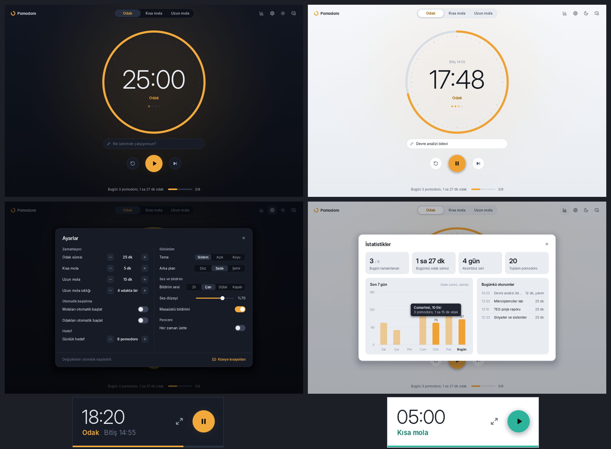

<p align="center"></p>

# Pomodoro (WorkX)

Windows için sade bir Pomodoro zamanlayıcısı. Açık ve koyu tema, görev takibi, günlük hedef, 7 günlük istatistik ve her zaman üstte duran kompakt pencere içerir. Kurulum gerektirmez, tek bir `WorkX.exe` dosyasıdır.



## İndir

[Releases](../../releases) sayfasından son `WorkX.exe` dosyasını indirip çalıştır. Windows 10 ve 11 (64-bit) desteklenir.

Dosya imzasız olduğu için Windows SmartScreen ilk açılışta uyarabilir: **Ek bilgi → Yine de çalıştır**.

## Özellikler

- **Zamanlayıcı:** odak, kısa mola ve uzun mola; uzun mola her N odakta bir gelir. Süre bitince sıradaki moda geçer, istenirse otomatik başlar.
- **Görev:** "Ne üzerinde çalışıyorsun?" alanına yazılan görev, tamamlanan oturumla birlikte kaydedilir.
- **İstatistikler:** bugün tamamlanan pomodoro, toplam odak süresi, kesintisiz seri, son 7 günün grafiği ve bugünkü oturum listesi.
- **Tema:** Sistem / Açık / Koyu. Sistem seçiliyse Windows temasını izler; Windows 11'de başlık çubuğu da temaya uyar.
- **Arka plan:** Düz, Sade (varsayılan) veya Şehir (alt kenarda siluet, koyu temada yıldızlar).
- **Bildirim:** üç ses seçeneği (Zil, Çan, Dijital) ve ses düzeyi, masaüstü bildirimi, görev çubuğunda yanıp sönme ve ilerleme çubuğu.
- **Kompakt pencere:** ekran köşesinde her zaman üstte duran küçük sayaç; boş yerinden sürüklenir, çift tıklayınca tam pencereye döner.
- **Tepsi simgesi:** sağ tık menüsünden başlat/duraklat, sıfırla, sonrakine geç, çıkış.
- **Hafif:** boştayken ekranı yeniden çizmez; çalışırken saniyede yaklaşık 4 kare çizer.

## Klavye kısayolları

| Tuş | İşlev |
| --- | --- |
| Boşluk | Başlat / duraklat |
| R | Sıfırla |
| N | Sonrakine geç |
| 1, 2, 3 | Odak, kısa mola, uzun mola |
| ↑ ↓ | Süreyi 1 dk değiştir (başlamadan önce) |
| E | Görevi düzenle |
| S | Ayarlar |
| I | İstatistikler |
| D | Açık / koyu tema |
| C | Kompakt pencere |
| P | Her zaman üstte |
| M | Sesi aç / kapat |
| F1 | Kısayol listesi |
| Esc | Kapat, vazgeç |

## Veriler nerede tutulur

Ayarlar, oturum geçmişi ve pencere konumu `%AppData%\Pomodoro\ayarlar.json` dosyasındadır. Bu dosyayı silmek uygulamayı ilk açılış durumuna döndürür.

## Kaynaktan derleme

Gereken tek şey [Go 1.24+](https://go.dev/dl/). Harici paket yoktur; arayüz doğrudan Win32 ve GDI çağrılarıyla çizilir.

Windows'ta:

```bat
build.bat
```

Linux veya macOS'ta (Windows için çapraz derleme):

```sh
./build.sh
```

Simge, sürüm bilgisi ve DPI manifesti `rsrc_windows_amd64.syso` dosyasıyla exe'ye gömülür. Simgeyi değiştirdiysen bu dosyayı yeniden üret:

```sh
go run . icon /tmp/simge          # simge PNG'leri (Linux)
python3 tools/mkrsrc.py /tmp/simge rsrc_windows_amd64.syso
```

## Proje yapısı

| Dosya | İçerik |
| --- | --- |
| `app.go` | Uygulama durumu, animasyonlar, girdi, oturum mantığı |
| `model.go` | Saf zamanlayıcı modeli |
| `store.go` | Ayarlar, oturum kayıtları, istatistik hesapları |
| `view.go`, `modal.go` | Ana ekran, kompakt pencere, ayarlar / istatistik / kısayol pencereleri |
| `theme.go`, `bg.go`, `icons.go` | Renk paleti, arka plan, vektör ikonlar ve uygulama simgesi |
| `gfx.go` | Kenar yumuşatmalı yazılım çizim katmanı |
| `sound.go` | Bildirim seslerinin bellekte üretilmesi (WAV) |
| `main_windows.go` | Windows kabuğu: pencere, DPI, tepsi, bildirim, görev çubuğu, ses |
| `snap_linux.go`, `tools/` | Geliştirme: Linux'ta ekran görüntüsü alma ve kaynak dosyası üretimi |

## Geliştirme

```sh
go test ./...                               # zamanlayıcı, istatistik, ayarlar ve tüm ekranların çizim testleri
python3 tools/widths.py /tmp/widths.json
SNAP_TMP=/tmp go run . shots /tmp/shots     # Linux'ta ekran görüntüleri (Pillow ve Inter yazı tipi gerekir)
```
